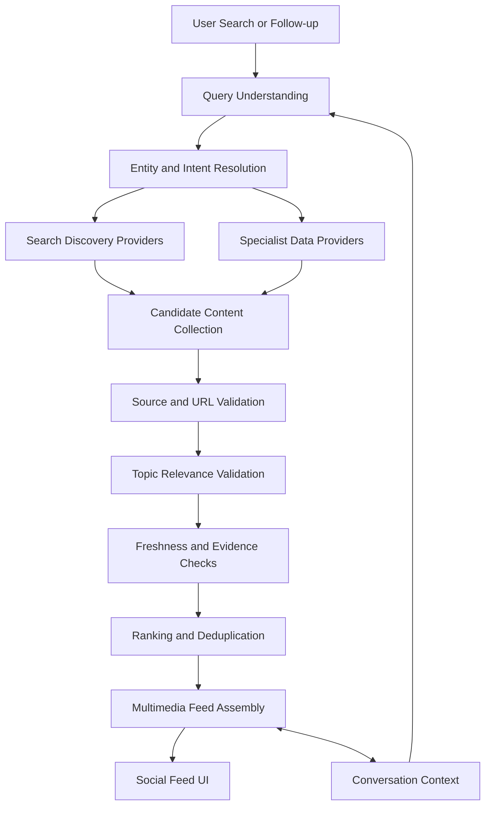

# AiRA — Conversational Live Social Discovery

**Discover the web. Explore the moment. Stay in the conversation.**

AiRA is a social-style content discovery platform designed to bring together relevant articles, photographs, videos, vlogs, breaking news, and live event updates through a conversational search experience.

Unlike a conventional search engine that presents a list of links, AiRA aims to transform a user's search into a dynamic, multimedia-rich feed. Users can explore a topic, discover related content, follow live developments, and ask follow-up questions without losing the context of the conversation.

The goal is simple: **make web discovery feel social, visual, conversational, and relevant — without compromising the authenticity of information.**

---

## ✨ Vision

AiRA combines three core experiences:

- **Discover:** Explore a topic through articles, photos, videos, vlogs, and related stories.
- **Follow:** Stay updated with live scores, event status, breaking developments, and progress updates.
- **Converse:** Ask follow-up questions, explore related topics, and keep the content feed synchronized with the ongoing conversation.

AiRA is intended to feel like a social content platform powered by intelligent search, rather than a traditional search-results page or a restrictive content filter.

## 🚀 Core Features

### 🔎 Conversational Search

Search for a person, brand, product, sports team, competition, technology, event, or general topic using natural language.

AiRA's intended search workflow includes:

- Query understanding and intent detection.
- Entity recognition and topic resolution.
- Search discovery across relevant providers.
- Context-aware retrieval and ranking.
- Follow-up question handling.
- Topic continuity across the conversation and feed.

### 📰 Live Curated Content Feed

Explore a mixed-content feed tailored to the current search topic.

Supported content categories include:

- **Blogs & News:** Articles, reports, announcements, analysis, and developing stories.
- **Photologs:** Editorial photography, official galleries, product images, and visual stories.
- **Vlogs & Videos:** Interviews, demonstrations, explainers, reviews, highlights, and video reporting.
- **Live Updates:** Scores, fixtures, standings, timing, event status, and progress updates.
- **Related Discoveries:** Contextual stories and adjacent topics that genuinely add value.

The feed is designed to prioritize relevance and diversity rather than forcing every query into the same result format.

### 🏟️ Live Sports & Event Intelligence

Sports queries require more than generic web search.

AiRA's intended sports discovery experience includes:

- Live scores and match status.
- Upcoming fixtures and schedules.
- Completed match results.
- Tournament standings.
- Race sessions, timing, and positions.
- Event dates, venues, and local start times.
- Match reports, interviews, photographs, and highlights.

Structured sports-data APIs and official scoreboards should provide live event information wherever suitable providers are available.

A live update must be associated with the correct event and include meaningful context. A score or timing fragment should never appear as an unrelated or unexplained feed item.

### 💬 Context-Aware AI Conversation

The conversational assistant and the feed should share the same topic context.

For example:

1. Search for `SA vs AUS cricket`.
2. Ask, `What's the score now?`
3. Ask, `When is the next match?`
4. Ask, `Show highlights too.`

AiRA should understand that these follow-ups relate to the same cricket matchup, retrieve fresh information where necessary, and update the feed accordingly.

When a user switches to a new topic, the active context should change without leaking unrelated results from previous searches.

### 🛡️ Trusted Information & Source Curation

AiRA aims to improve content authenticity through a source-governance layer.

The intended approach includes:

- Approved publishers and official websites.
- Established sports broadcasters and specialist publications.
- Official product documentation and brand announcements.
- Authorized sports-data providers.
- Valid source attribution and traceable links.
- Publication, retrieval, and verification timestamps.
- Relevance checks before content enters the feed.
- Clear handling of conflicting or unavailable information.

Facebook, Instagram, X, and Threads posts are excluded as factual sources for the curated discovery pipeline.

Source approval and topical relevance are separate requirements: an approved publisher can still produce a result that is irrelevant to the user's query.

### 🎨 Social-First Experience

AiRA is designed around a visual, engaging browsing experience rather than a conventional search-results list.

The intended interface includes:

- Mixed-media feed cards.
- Image-led articles and visual stories.
- Video and vlog previews.
- Distinct live-event cards.
- Topic-aware content filtering.
- Incremental feed loading and refresh.
- Conversational follow-ups.
- Source attribution without overwhelming the content.

The emphasis is on keeping discovery engaging while making information quality a background system responsibility.

---

## 🧠 How It Works

AiRA's target architecture separates discovery, verification, relevance, and presentation.



### Search discovery

A configurable web-search provider discovers candidate content. Additional provider-specific searches may be used to improve coverage.

### Specialist retrieval

Structured providers supply information that general search cannot reliably guarantee, such as current sports scores, event schedules, and standings.

### Verification and relevance

Candidates are checked for source eligibility, topical relevance, metadata quality, freshness, and traceable evidence before being presented.

### Feed and conversation

The feed and conversational assistant use shared topic context so that follow-up questions update the same subject rather than triggering unrelated discovery.

> The diagram represents the intended architecture. Actual implementation status depends on the integrations and components currently present in the repository.

---

## 🎯 Search Relevance Principles

AiRA should optimize for meaningful discovery, not merely matching keywords.

### Example: `Ferrari`

A broad search should discover relevant content about:

- Ferrari road cars and product announcements.
- Scuderia Ferrari and Formula 1.
- Ferrari-related news and analysis.
- Official images and editorial photography.
- Interviews, reviews, and videos.
- Relevant race updates when an event provides a genuine connection.

A Charles Leclerc timing update should not dominate the feed unless it is connected to a relevant Formula 1 session and provides meaningful event context.

### Example: `SA vs AUS cricket`

The search should resolve the matchup to South Africa versus Australia in cricket and retrieve relevant fixtures, scorecards, match reports, videos, and related news.

If no match is currently live, the application should show relevant upcoming fixtures, recent results, or other useful cricket content instead of unrelated sports updates.

### Example: `Tesla flying car`

The feed should discover relevant reporting, aviation technology, photographs, and videos while distinguishing confirmed information from speculation.

An unrelated football scorecard must never enter the main feed simply because a live-score provider returned it.

---

## 📡 Data Source Strategy

AiRA is designed to use a configurable, category-aware provider architecture.

Potential provider categories include:

| Category | Preferred source types |
|---|---|
| General discovery | Supported, documented web-search APIs |
| Sports news | Approved sports broadcasters and specialist publishers |
| Live sports | Official scoreboards and authorized sports-data APIs |
| News | Established editorial publishers and original reporting |
| Technology | Official documentation, engineering blogs, and specialist publications |
| Brands & products | Official product pages, newsrooms, and authorized documentation |
| Photos & videos | Authorized publisher media, official galleries, and permitted video integrations |

Potential providers should be evaluated for coverage, freshness, reliability, licensing, API availability, and commercial usage terms before production integration.

AiRA should not depend on scraping search-engine results pages or undocumented APIs.

The provider layer should allow new approved integrations to be added without rewriting the entire search or feed system.

---

## 🔐 Reliability, Freshness & Safety

The following principles guide the data pipeline:

- **Relevance first:** Unrelated content must not enter the main feed.
- **Source authenticity:** Every factual result should have traceable provenance.
- **Freshness awareness:** Newly retrieved content is not necessarily newly published content.
- **Live-data integrity:** Never invent scores, event states, or timing values.
- **Context isolation:** Results from an earlier search must not leak into a new topic.
- **Evidence-grounded AI:** Summaries should be supported by retrieved source material.
- **Graceful failures:** Missing or stale data should be identified honestly.
- **Privacy and security:** Protect API credentials and validate external URLs.
- **Responsible media use:** Respect publisher terms, copyright, licensing, and permitted embedding.

Trust controls should improve the user experience without unnecessarily narrowing content discovery.

---

## 🛠️ Technology & Integrations

AiRA's final technology stack and active integrations should be documented from the actual project configuration.

The intended integration capabilities include:

- Conversational AI and query understanding.
- Configurable web-search providers.
- Structured sports-data APIs.
- Approved publisher feeds and APIs.
- Media metadata and authorized embeds.
- Source validation and relevance ranking.
- Caching, background refresh, and error handling.
- Conversation and feed-context management.

**Implementation note:** Replace this section with the confirmed frontend framework, backend framework, database, AI provider, search provider, and sports-data providers once verified from the repository. Do not publish API keys or credentials.

---

## ⚙️ Getting Started

Setup instructions depend on the technologies and package managers used in the repository.

### Prerequisites

Before running AiRA, identify the project's required runtime, package manager, database, and external services.

### Installation

Clone the repository:

```bash
git clone <YOUR_REPOSITORY_URL>
cd <YOUR_PROJECT_DIRECTORY>
```

Install dependencies using the package manager configured by the project.

Create the required local environment configuration using the project's documented example file.

Configure the necessary API credentials and provider settings.

Run the application using the scripts defined in the project configuration.

**Important:** The commands above are a setup outline. Add the exact installation, development, testing, and production commands after confirming the repository's actual configuration.

### Environment Configuration

Document the environment variables required by the implemented integrations. For example, the following are illustrative names, not confirmed project variables:

```dotenv
AI_PROVIDER_API_KEY=
WEB_SEARCH_API_KEY=
SPORTS_DATA_API_KEY=
DATABASE_URL=
```

Use server-side secret management. Never commit real API keys, tokens, passwords, or production connection strings.

---

## 🧪 Testing & Quality Assurance

AiRA should be validated against real search scenarios, not only successful application builds.

Recommended regression scenarios:

- Broad searches return a diverse, relevant content feed.
- Ferrari searches do not surface unrelated sports events.
- South Africa versus Australia cricket searches return cricket-specific content.
- Live scores display the correct event, date, status, and provider timestamp where available.
- Follow-up questions retain the active conversation topic.
- Explicit topic changes do not retain stale results.
- Prohibited social media sources do not enter factual search results.
- Unsupported claims and invalid citations are rejected.
- Provider outages do not cause fabricated results.
- Existing UI components and visual styling remain intact.

Quality should be assessed through relevance, source diversity, freshness, duplicate rates, citation validity, and successful live-data updates.

---

## 🗺️ Roadmap

The following is a proposed roadmap, not a claim that every capability is already implemented.

- [ ] Complete search-pipeline audit and root-cause diagnostics.
- [ ] Integrate and validate a configurable web-search provider.
- [ ] Improve query understanding and entity resolution.
- [ ] Implement a reliable topic-relevance gate.
- [ ] Improve sports matchup and live-event resolution.
- [ ] Expand approved article, photo, and video discovery.
- [ ] Synchronize conversation context and feed state.
- [ ] Add provider health monitoring and freshness diagnostics.
- [ ] Complete search relevance regression tests.
- [ ] Document production integrations, setup, and deployment.

---

## 🤝 Contributing

Contributions should prioritize meaningful discovery, accurate information, reliable source attribution, and a consistent social-feed experience.

When submitting changes:

1. Explain the problem being addressed.
2. Identify affected integrations and components.
3. Include tests for relevant behavior.
4. Verify that unrelated results cannot enter the main feed.
5. Preserve existing visual conventions unless a UI change is explicitly intended.
6. Document new provider requirements and licensing considerations.

Do not submit fabricated sample data as evidence of working live integrations.

---

## 📄 License

Add the project's actual license here once it has been selected. Until then, no license is implied by this README.

---

## 💡 The AiRA Philosophy

AiRA is built around a simple idea:

**Search should start a discovery, not end with a list of links.**

The right information should lead to the right stories, visuals, updates, and conversations — all connected by context and grounded in credible sources.

Discover more. Stay informed. Keep the conversation alive.

**AiRA — Conversational Live Social Discovery.**
