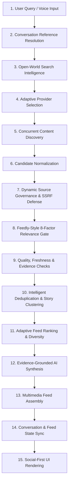

# AiRA Central Search Engine Architecture
**Document:** `docs/SEARCH_ENGINE_ARCHITECTURE.md`  
**Status:** Architecture Specification & Reference Implementation  
**Date:** 2026-10-25  
**Version:** 2.0.0 (Universal Intelligence & Feedly-Grade Discovery)  

---

## 1. Architectural Philosophy & Objective

AiRA (*Conversational Live Social Discovery*) is designed as an open-world, universal discovery engine:
> *"Discover anything. Find what matters. Stay in the conversation."*

The architecture combines **Feedly's content relevance, source intelligence, and cross-publisher story clustering** with **conversational AI context memory** and a **responsive social multimedia feed**. It operates without closed-world topic constraints, rigid entity boundaries, or hardcoded query rules.

---

## 2. End-to-End Logical Workflow

### 13-Stage Pipeline Breakdown

| Stage | Responsibility | Primary Component | Key Output |
|---|---|---|---|
| **1. User Input** | Captures natural language text or Web Speech audio. | [`src/App.tsx`](file:///data/data/com.termux/files/home/AiRA/src/App.tsx) | Raw query string |
| **2. Conversation Reference** | Distinguishes conversational follow-ups from explicit context switches. | [`src/engine/conversationState.ts`](file:///data/data/com.termux/files/home/AiRA/src/engine/conversationState.ts) | `ConversationReferenceResolution` |
| **3. Search Intelligence** | Extracts open-world entities, classifies 14+ domains, detects intent, and expands queries. | [`src/engine/queryUnderstanding.ts`](file:///data/data/com.termux/files/home/AiRA/src/engine/queryUnderstanding.ts) | `QueryInterpretation` |
| **4. Provider Selection** | Selects search discovery and specialist providers dynamically based on domain and intent. | [`src/engine/skillOrchestrator.ts`](file:///data/data/com.termux/files/home/AiRA/src/engine/skillOrchestrator.ts) | `ActiveSkillPlan` |
| **5. Content Discovery** | Executes Brave Search, Guardian, or Universal Ecosystem providers concurrently. | [`src/engine/discoveryLayer.ts`](file:///data/data/com.termux/files/home/AiRA/src/engine/discoveryLayer.ts) | `DiscoveryProviderOutput` |
| **6. Normalization** | Converts provider payloads into uniform `CandidateItem` schemas with provenance. | [`src/engine/types.ts`](file:///data/data/com.termux/files/home/AiRA/src/engine/types.ts) | `CandidateItem[]` |
| **7. Source Governance** | Enforces social media blocklist, SSRF checks, spoof checks, and admits verified domains. | [`src/engine/urlSecurity.ts`](file:///data/data/com.termux/files/home/AiRA/src/engine/urlSecurity.ts) | `canonicalUrl`, `matchedSource` |
| **8. Relevance Gate** | Computes Feedly-style 0–100 scores; applies fail-closed hard rejection for off-topic items. | [`src/engine/relevanceScorer.ts`](file:///data/data/com.termux/files/home/AiRA/src/engine/relevanceScorer.ts) | `RelevanceScoreBreakdown` |
| **9. Quality & Freshness** | Validates timestamp freshness policies and protects against prompt injection. | [`src/engine/freshnessPolicy.ts`](file:///data/data/com.termux/files/home/AiRA/src/engine/freshnessPolicy.ts) | `FreshnessStatus` |
| **10. Story Clustering** | Eliminates duplicates, detects wire syndication, and groups multi-publisher coverage. | [`src/engine/storyClustering.ts`](file:///data/data/com.termux/files/home/AiRA/src/engine/storyClustering.ts) | `StoryClusterGroup[]`, `DevelopingStoryStream` |
| **11. Adaptive Ranking** | Applies intent-adaptive weighting, corroboration bonuses, and publisher diversity limits. | [`src/engine/verificationPipeline.ts`](file:///data/data/com.termux/files/home/AiRA/src/engine/verificationPipeline.ts) | Ranked `StandardizedSearchResult[]` |
| **12. Grounded AI** | Synthesizes verified evidence into key takeaways without hallucinating citations. | [`src/engine/searchOrchestrator.ts`](file:///data/data/com.termux/files/home/AiRA/src/engine/searchOrchestrator.ts) | `GroundedSummaryOutput` |
| **13. Feed Assembly** | Builds mixed-media cards (Articles, Photologs, Vlogs, Scorecards, Timelines). | [`src/engine/searchOrchestrator.ts`](file:///data/data/com.termux/files/home/AiRA/src/engine/searchOrchestrator.ts) | `SocialDiscoveryFeed` |

---

## 3. Modular Component Responsibilities

### 3.1 Search Intelligence Layer (`src/engine/queryUnderstanding.ts`)
* **Open-World Entity Extraction (`extractOpenWorldEntities`):** Extracts quotes (`"..."`), comparisons (`"X vs Y"`), proper noun sequences, and acronyms.
* **Domain Classification (`classifyOpenWorldDomain`):** Heuristic classifier supporting 14+ domains (*science, automotive, software_ai, consumer_tech, health, finance, food, travel, politics, culture, entertainment, gaming, environment, education*).
* **Focused Query Expansion (`buildTargetedProviderQueries`):** Generates 2–4 targeted provider variations without semantic drift.

### 3.2 Provider Discovery Layer (`src/engine/discoveryLayer.ts`)
* **Vendor Abstraction:** Common `SearchDiscoveryProvider` interface for commercial APIs and open syndication.
* **Resilience:** Integrates with `ProviderResilienceManager` for request coalescing, circuit breakers, and exponential backoff.
* **Universal Open Discovery:** `UniversalOpenDiscoveryProvider` queries category-aligned public feeds and open web syndication when private API keys are absent.

### 3.3 Dynamic Source Intelligence & Security (`src/engine/urlSecurity.ts`, `sourceRegistry.ts`)
* **Strict Social Denylist:** Facebook, Instagram, X/Twitter, Threads, Reddit, TikTok, LinkedIn, Pinterest, Mastodon, and Bluesky remain permanently blocked from factual discovery.
* **Security Filters:** SSRF checks, unapproved URL shortener resolution, and brand-spoofing lookalike detection.
* **Dynamic Admission:** Legitimate open-world publisher domains (`.edu`, `.gov`, `.org`, verified publishers) are dynamically verified and admitted into `SourceRegistryService` with assigned trust tiers.

### 3.4 Feedly-Style Relevance Engine (`src/engine/relevanceScorer.ts`)
* Evaluates 8 factors: Topic Relevance (35%), Entity Matching (20%), Source Credibility (15%), Freshness (10%), Content Quality (10%), Originality (5%), Media Relevance (5%).
* **Fail-Closed Gate:** An article with poor topical relevance ($< 25\%$) is hard-rejected regardless of publisher trust tier.

### 3.5 Story Clustering & Deduplication (`src/engine/storyClustering.ts`)
* **Headline Token Jaccard Similarity:** Compares headlines across articles published within a 48-hour window.
* **Cluster Groups:** The highest-tier article becomes the primary card, and secondary articles are attached as `relatedCoverage: [...]`. Multi-publisher developments spawn `DevelopingStoryStream` timelines.

### 3.6 Conversation Context Manager (`src/engine/conversationState.ts`)
* Maintains session state across turns, inheriting entities and filters on follow-up questions while isolating context on explicit topic changes.

---

## 4. Performance & Reliability Guarantees

* **Request Coalescing:** Simultaneous identical queries are coalesced into a single inflight execution via `globalResilienceManager.coalesce`.
* **Category-Aware Memory Cache:** In-memory LRU cache with configurable TTLs (e.g. 1 minute for live scores, 15 minutes for articles, 2 hours for historical queries).
* **Zero-Hallucination Grounding:** AI summaries are generated exclusively from verified candidate excerpts; missing information produces honest empty-state notices.
