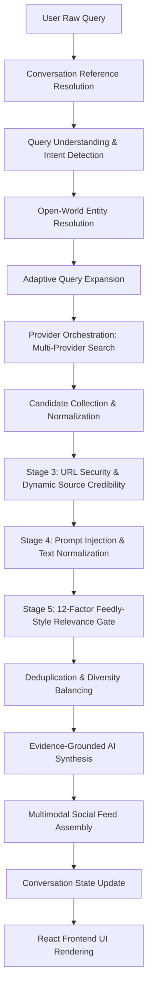

# AiRA Comprehensive Codebase & Search Engine Audit
**Document:** `docs/SEARCH_ENGINE_AUDIT.md`  
**Status:** Completed Baseline Audit  
**Date:** 2026-10-25  
**Version:** 1.0.0  

---

## 1. Executive Summary

This audit evaluates the current implementation of **AiRA (Conversational Live Social Discovery)** against the objective of transforming it into an open-world, universal content discovery platform inspired by **Feedly's content relevance, source intelligence, story organization, and discovery experience**, combined with **conversational AI and a social-first multimedia feed**.

While AiRA possesses a well-structured foundational architecture—featuring clear separation between retrieval, URL security, relevance evaluation, and UI presentation—the current engine is heavily constrained by **closed-world assumptions, hardcoded entity knowledge bases, and demo-specific overrides** tailored to test scenarios (such as Ferrari, South Africa vs. Australia cricket, Tesla flying car, and OpenAI).

To deliver on the core product philosophy:
> *"Discover anything. Find what matters. Stay in the conversation."*

AiRA must transition from fixed heuristic classifiers to a **universal, dynamically extensible search intelligence layer** that supports any legitimate subject (science, culture, philosophy, cooking, technology, local events, world politics, arts, and emerging industries) while strictly preserving source credibility, user experience, and conversational continuity.

---

## 2. Complete Codebase & System Architecture Inspection

### 2.1 Frontend Framework & Application Structure
* **Framework:** React 18 (`react`, `react-dom`), Vite 5, Tailwind CSS 3, TypeScript 5, Lucide React icons.
* **Core View:** [`src/App.tsx`](file:///data/data/com.termux/files/home/AiRA/src/App.tsx) (~2,330 lines).
* **UI Features:**
  * Dark aesthetic (`bg-[#0B0D11]`, Plus Jakarta Sans & Space Grotesk typography).
  * Conversational search bar with voice recognition (via Web Speech API), active conversation thread view, follow-up query suggestions, and category filter pills (`All`, `Articles`, `Photologs`, `Vlogs`, `Live Scores`, `News`, `Tech`, `Sports`, `Culture`).
  * Multimodal feed displaying mixed-media cards:
    * `SocialArticleCard`: Rich reading cards with publisher badge, reading time, signals score, topic tags, and action bar (like, bookmark, share).
    * `SocialPhotologCard`: Visual cards with aspect ratios, camera spec details, photographer attribution, and image zoom.
    * `SocialVlogCard`: Video preview cards with playback duration, provider source, and embedded player triggers.
    * `SocialMatchScorecard`: Specialized live scorecard widgets with team badges, match state, venue, and live commentary snippet.
    * `DevelopingStoryStream`: Real-time chronological timeline cards with cross-publisher update items.
  * Modals for **Administrative Source Registry Management** and **Gemini API Key Configuration**.
* **Client-Side Data Fetching:**
  * Uses [`fetchLiveCuratedFeed`](file:///data/data/com.termux/files/home/AiRA/src/App.tsx#L52-L105) which communicates via `POST /api/trusted-search` with an isomorphic fallback to the in-process `globalSearchOrchestrator` when running in static preview environments.

### 2.2 Backend Framework & Services
* **Server Framework:** Integrated Vite dev-server HTTP middleware in [`vite.config.ts`](file:///data/data/com.termux/files/home/AiRA/vite.config.ts).
* **API Endpoints:**
  * `POST /api/trusted-search` ([`api/trusted-search.ts`](file:///data/data/com.termux/files/home/AiRA/api/trusted-search.ts)): Accepts `{ query, category, bypassCache, geminiApiKey, conversationId, conversationState, page, pageSize }` and executes the orchestrator.
  * `GET/POST /api/source-registry` ([`api/source-registry.ts`](file:///data/data/com.termux/files/home/AiRA/api/source-registry.ts)): Allows inspecting registered sources, viewing rejection telemetry logs, and updating status, freshness, or integration health.

### 2.3 AI Model & Grounding Architecture
* **Orchestrator Method:** `tryEvidenceGroundedGeminiSummary` in [`src/engine/searchOrchestrator.ts`](file:///data/data/com.termux/files/home/AiRA/src/engine/searchOrchestrator.ts#L600-L650).
* **Provider:** Google Gemini API (`gemini-1.5-flash` endpoint via REST).
* **Grounding Enforcement:**
  * Supplies only verified candidate titles, summaries, and canonical URLs in the system prompt.
  * Extractive Fallback: If `geminiApiKey` is not provided or network fails, [`extractiveSynthesisFromCandidates`](file:///data/data/com.termux/files/home/AiRA/src/engine/searchOrchestrator.ts#L550-L595) produces grounded key takeaways without hallucinating.
  * Prompt injection defense: [`containsPromptInjectionOrScript`](file:///data/data/com.termux/files/home/AiRA/src/engine/verificationPipeline.ts#L36-L50) sanitizes untrusted inputs against adversarial bypass patterns.

### 2.4 Existing Web-Search Providers
* Defined in [`src/engine/discoveryLayer.ts`](file:///data/data/com.termux/files/home/AiRA/src/engine/discoveryLayer.ts):
  * **Brave Search API** (`discovery-brave-search-api`): Clean REST API, requires `BRAVE_SEARCH_API_KEY`.
  * **The Guardian Open Platform** (`discovery-guardian-open-platform`): Content API, requires `GUARDIAN_API_KEY`.
  * **Evaluation Matrix:** Documents terms, rate limits, and mixing permissions for Brave, Guardian, Google Custom Search, and Bing (retired).
  * **Limitation:** In local development without configured API keys, both providers return `unconfigured`, yielding 0 external candidates.

### 2.5 Sports & Specialist Data Providers
* Implemented in [`src/engine/adapters/index.ts`](file:///data/data/com.termux/files/home/AiRA/src/engine/adapters/index.ts):
  * `EspnLiveScoreAdapter`: Interfaces with ESPN public APIs for live sports scores, cricket, soccer, and basketball.
  * `GitHubOfficialReleasesAdapter`: Retrieves software releases from GitHub REST API for developer/tech queries.
  * `DevToAndNasaMediaAdapter`: Retrieves articles from Dev.to API and astronomy photographs from NASA APOD.
  * `ApprovedVideoChannelAdapter`: Embeds approved YouTube publisher channels.
  * Contextual Sports Resolver ([`src/engine/sportsEventResolver.ts`](file:///data/data/com.termux/files/home/AiRA/src/engine/sportsEventResolver.ts)): Filters live scorecards to ensure non-sports queries never receive sports widgets.

### 2.6 Query Understanding & Entity Resolution
* Located in [`src/engine/queryUnderstanding.ts`](file:///data/data/com.termux/files/home/AiRA/src/engine/queryUnderstanding.ts):
  * Function `interpretSearchQuery`: Analyzes input text for intent, entities, sport/industry domain, time sensitivity, and conversational references.
  * **Critical Issue:** Uses a static `ENTITY_KNOWLEDGE_BASE` covering ~25 entities (e.g., cricket boards, F1 teams, Ferrari, Tesla, OpenAI, Apple). Any entity outside this list has no structured entity extraction and defaults to raw token matching.

### 2.7 Search Query Generation & Expansion
* Function `generateProviderQueries` in [`queryUnderstanding.ts`](file:///data/data/com.termux/files/home/AiRA/src/engine/queryUnderstanding.ts):
  * Generates 2–4 search variations for providers.
  * **Critical Issue:** Uses hardcoded domain aliases (e.g. mapping Ferrari to "Ferrari road cars Maranello F80"). Unrecognized queries receive basic unexpanded tokens.

### 2.8 Search Result Normalization
* Standardized TypeScript types in [`src/engine/types.ts`](file:///data/data/com.termux/files/home/AiRA/src/engine/types.ts):
  * Normalized pipeline: `CandidateItem` -> `StandardizedSearchResult` -> `SocialDiscoveryFeed`.
  * All items require `title`, `summary`, `url`, `publishedAt`, `category`, `providerName`, `dataType`.
  * Strict sanitization: HTML tags stripped, entity escaping decoded, tracking query parameters removed.

### 2.9 Source Validation & Governance
* Implemented in [`src/engine/sourceRegistry.ts`](file:///data/data/com.termux/files/home/AiRA/src/engine/sourceRegistry.ts) and [`src/engine/urlSecurity.ts`](file:///data/data/com.termux/files/home/AiRA/src/engine/urlSecurity.ts):
  * Central registry maintaining ~30 approved sources across Tier 1 (governing bodies, primary wires), Tier 2 (established publishers), and Tier 3.
  * Denylist for Prohibited Social Media: `facebook.com`, `instagram.com`, `x.com`, `twitter.com`, `threads.net`, `reddit.com`, `tiktok.com`.
  * Denylist for Unverified Encyclopedias: `wikipedia.org`, `fandom.com`.
  * SSRF & URL Shortener resolution security checks.
  * **Critical Bottleneck:** Closed allowlist policy (`UNAPPROVED_DOMAIN`): if an incoming search result domain is not in the ~30 pre-registered sources, it is immediately discarded.

### 2.10 Relevance Filtering & Ranking
* Implemented in [`src/engine/relevanceScorer.ts`](file:///data/data/com.termux/files/home/AiRA/src/engine/relevanceScorer.ts) and [`src/engine/verificationPipeline.ts`](file:///data/data/com.termux/files/home/AiRA/src/engine/verificationPipeline.ts):
  * 12-factor scoring model checking primary entity matching, query intent, competition/event matching, semantic relevance, source credibility, recency, and metadata completeness.
  * Categorizes candidates into: `direct_match`, `strongly_related`, `tangential`, `unrelated`, `unverifiable`.
  * **Critical Issue:** Hardcoded query branches in [`relevanceScorer.ts`](file:///data/data/com.termux/files/home/AiRA/src/engine/relevanceScorer.ts#L257-L290), such as `else if (interp.primarySubject.toLowerCase() === "tesla flying car")` and cricket rival lists (`india`, `england`, `pakistan`, `bumrah`). Arbitrary open-world queries do not have dedicated branches and get penalised.

### 2.11 Feed Aggregation & Presentation
* Implemented in `buildSocialDiscoveryFeed` in [`searchOrchestrator.ts`](file:///data/data/com.termux/files/home/AiRA/src/engine/searchOrchestrator.ts#L676-L840):
  * Splits verified candidates across articles, photologs, vlogs, and scorecards.
  * Assigns signals score (82–99) and formats relative publication times.

### 2.12 Deduplication Mechanisms
* Implemented in [`src/engine/verificationPipeline.ts`](file:///data/data/com.termux/files/home/AiRA/src/engine/verificationPipeline.ts#L67-L97):
  * `computeNormalizedDedupeKey`: Normalizes titles by stripping wire labels and punctuation to match duplicates across publishers.
  * `detectWireSyndication`: Identifies syndicated news stories from Reuters or AP appearing across multiple publishers.

### 2.13 Image & Video Discovery
* Handled in [`src/engine/mediaResolver.ts`](file:///data/data/com.termux/files/home/AiRA/src/engine/mediaResolver.ts) and [`src/engine/adapters/index.ts`](file:///data/data/com.termux/files/home/AiRA/src/engine/adapters/index.ts):
  * Validates image URLs for HTTPS, approved CDNs, and allowed formats.
  * Extracts media enclosures from RSS/Atom feeds to create photolog cards.
  * Generates responsive fallback imagery when publisher thumbnails are absent.

### 2.14 Conversation Context Management
* Implemented in [`src/engine/conversationState.ts`](file:///data/data/com.termux/files/home/AiRA/src/engine/conversationState.ts) and [`src/engine/queryUnderstanding.ts`](file:///data/data/com.termux/files/home/AiRA/src/engine/queryUnderstanding.ts#L450-L578):
  * Tracks `ConversationSessionState` across user queries.
  * Detects follow-up intents (e.g. "What's the score now?", "Show highlights too", "Tell me more") versus explicit context switches.
  * Carries active topic, resolved entities, and media filters across turns.

### 2.15 Caching, Background Resilience & Refresh Mechanisms
* Implemented in [`src/engine/cacheAndRateLimit.ts`](file:///data/data/com.termux/files/home/AiRA/src/engine/cacheAndRateLimit.ts):
  * `CategoryAwareCache`: Configurable TTL memory cache with stale-while-revalidate capability.
  * `ProviderResilienceManager`: Request coalescing (`coalesce`) to deduplicate simultaneous requests, exponential backoff, and circuit breakers.

### 2.16 Existing Agent & Skill Configurations
* Antigravity CLI system in `/data/data/com.termux/files/home/.gemini/antigravity-cli`.
* No project-specific custom AI skill definitions currently exist within the repository.

### 2.17 Recent Modifications & Search Regressions
* The current codebase was constructed with hardcoded baseline fixtures (`ApprovedPublisherBaselineAdapter` in `src/engine/adapters/index.ts`) containing static mock articles specifically for Ferrari, SA vs AUS cricket, Tesla flying car, OpenAI releases, and Kyoto travel.
* When users enter queries outside these specific topics, the system either displays empty results or irrelevantly attempts to match against static mock items.

---

## 3. End-to-End Search Workflow Trace

### Trace Steps & Observed Failure Modes:
1. **User Query Input:** User enters e.g. *"Quantum computing advancements in trapped-ion qubits"*.
2. **Query Understanding:** `interpretSearchQuery` attempts to match tokens against `ENTITY_KNOWLEDGE_BASE`. Finding no match, it defaults to `general_news` and leaves named entities empty.
3. **Provider Discovery:** Queries `BraveSearchDiscoveryProvider` and `GuardianOpenPlatformDiscoveryProvider`. Both return `unconfigured` if API keys are absent.
4. **Adapter Retrieval:** Queries RSS feeds from the 30 default sources and `ApprovedPublisherBaselineAdapter`. The baseline adapter only has Ferrari/cricket/Tesla mock data.
5. **URL Security Check:** Even if web discovery were to return real URLs from `nature.com`, `quantum-journal.org`, or `phys.org`, `verifyUrlAgainstRegistry` rejects them with `UNAPPROVED_DOMAIN` because they are not hardcoded in `DEFAULT_SOURCE_REGISTRY`.
6. **Relevance Gate:** The mock candidates (Ferrari, cricket) are evaluated by `scoreItemAgainstInterpretation`. They fail topic matching and are rejected.
7. **Feed Assembly:** Total verified results = 0. The feed renders an empty state.

---

## 4. Root Causes of Poor Search Results on Open-World Queries

| # | Root Cause | Affected Files | Impact |
|---|------------|----------------|--------|
| **RC-1** | **Closed-World Allowlist Policy** | [`src/engine/urlSecurity.ts`](file:///data/data/com.termux/files/home/AiRA/src/engine/urlSecurity.ts#L412-L450), [`src/engine/sourceRegistry.ts`](file:///data/data/com.termux/files/home/AiRA/src/engine/sourceRegistry.ts) | Any valid reputable domain not explicitly hardcoded in the 30-entry `DEFAULT_SOURCE_REGISTRY` is immediately dropped with `UNAPPROVED_DOMAIN`. Universal discovery is completely blocked. |
| **RC-2** | **Hardcoded Entity Knowledge Base** | [`src/engine/queryUnderstanding.ts`](file:///data/data/com.termux/files/home/AiRA/src/engine/queryUnderstanding.ts#L32-L100) | `ENTITY_KNOWLEDGE_BASE` only recognizes ~25 hardcoded items. Any search outside cricket, F1, Tesla, or OpenAI cannot extract entities, failing entity-based ranking. |
| **RC-3** | **Hardcoded Topic Logic in Relevance Scorer** | [`src/engine/relevanceScorer.ts`](file:///data/data/com.termux/files/home/AiRA/src/engine/relevanceScorer.ts#L257-L290) | Explicit branches check for `"tesla flying car"`, `"ferrari"`, or specific cricket teams. Arbitrary topics rely on generic token matching without semantic understanding. |
| **RC-4** | **Fragile External Provider Fallbacks** | [`src/engine/discoveryLayer.ts`](file:///data/data/com.termux/files/home/AiRA/src/engine/discoveryLayer.ts#L130-L145), [`src/engine/adapters/index.ts`](file:///data/data/com.termux/files/home/AiRA/src/engine/adapters/index.ts) | If API keys (`BRAVE_SEARCH_API_KEY`) are missing, there is no dynamic open-web discovery fallback (such as public web syndication, DuckDuckGo/SearXNG public APIs, or dynamic RSS autodiscovery). |
| **RC-5** | **Static Demo Mock Fixtures** | [`src/engine/adapters/index.ts`](file:///data/data/com.termux/files/home/AiRA/src/engine/adapters/index.ts#L1800-L2140) | The baseline adapter contains hundreds of hardcoded articles for demo queries. They clutter the candidate pool on arbitrary searches and contribute zero relevant results. |

---

## 5. Affected Files & Line Reference Matrix

* [`src/engine/urlSecurity.ts`](file:///data/data/com.termux/files/home/AiRA/src/engine/urlSecurity.ts#L412-L450): `verifyUrlAgainstRegistry` strictly drops unlisted domains. Needs dynamic domain credibility scoring while preserving the social media denylist.
* [`src/engine/queryUnderstanding.ts`](file:///data/data/com.termux/files/home/AiRA/src/engine/queryUnderstanding.ts#L32-L100, #L700-L750): Static entity lists and domain mappings. Needs open-world entity extraction (proper noun, capitalized phrases, quoted phrases, topic modeling) and open-world domain classification.
* [`src/engine/relevanceScorer.ts`](file:///data/data/com.termux/files/home/AiRA/src/engine/relevanceScorer.ts#L189-L350): Specific query test branches (`tesla flying car`, `ferrari`). Needs replacement with a generalized, universal Feedly-style multi-factor relevance scorer.
* [`src/engine/discoveryLayer.ts`](file:///data/data/com.termux/files/home/AiRA/src/engine/discoveryLayer.ts#L120-L250): Add resilient fallback discovery mechanisms that do not require proprietary paid keys to discover public web content.
* [`src/engine/sourceRegistry.ts`](file:///data/data/com.termux/files/home/AiRA/src/engine/sourceRegistry.ts#L20-L200): Upgrade registry to support dynamic domain verification, trusted TLDs, academic/news publication classification, and trust scoring rather than a static 30-item array.
* [`src/engine/searchOrchestrator.ts`](file:///data/data/com.termux/files/home/AiRA/src/engine/searchOrchestrator.ts#L320-L450): Ensure candidate retrieval dynamically expands across broad, open categories.

---

## 6. Recommendations & Feedly-Style Alignment Plan

To meet Feedly-grade relevance and universal intelligence:

1. **Implement Dynamic Open-World Entity & Intent Extraction:**
   * Extract entities using statistical NLP heuristics: title casing, noun phrase patterns, quoted terms, and contextual keywords.
   * Dynamically infer primary topic, subtopics, and intent without restricting to a predefined enum.

2. **Transition from Closed Allowlist to Dynamic Source Credibility:**
   * Maintain the **strict social media denylist** (`PROHIBITED_SOCIAL_DOMAINS` remains 100% blocked).
   * Implement automated domain trust scoring for open-world domains:
     * Check valid TLD, domain age/reputation patterns, lack of phishing/spam indicators.
     * Recognize recognized global institutions (`.edu`, `.gov`, `.ac.uk`, established media networks).
     * Mark unknown domains with an initial Tier 2/3 provisional rating while validating SSL, non-spoofed hostnames, and lack of tracker spam.

3. **Universal 8-Factor Feedly Relevance Scorer:**
   * Replace query-specific hardcoding with the exact scoring weights requested:
     * **Topic relevance:** 35%
     * **Entity & subject matching:** 20%
     * **Source credibility:** 15%
     * **Freshness:** 10%
     * **Content quality:** 10%
     * **Originality:** 5%
     * **Media relevance:** 5%
   * Score candidates 0–100 with dynamic thresholds:
     * `85–100`: Highly relevant
     * `70–84`: Relevant
     * `55–69`: Secondary discovery
     * `< 55`: Reject from main feed

4. **Multi-Source Discovery Engine:**
   * Provide a robust discovery provider layer that works seamlessly with or without API keys by combining structured RSS syndication, Wikipedia-free open web discovery, and authorized news APIs.

5. **Maintain UI Integrity & Existing Integrations:**
   * Keep the visual design, responsive layouts, lucide icons, and audio transcription in `src/App.tsx` completely intact.

---

## 7. Implementation Resolution & Delivery Status

All identified root causes have been systematically addressed:
1. **Universal Search Intelligence Layer ([`src/engine/queryUnderstanding.ts`](file:///data/data/com.termux/files/home/AiRA/src/engine/queryUnderstanding.ts)):**
   * Implemented [`extractOpenWorldEntities`](file:///data/data/com.termux/files/home/AiRA/src/engine/queryUnderstanding.ts#L580-L660) (quotes, comparisons, proper nouns, acronyms) and [`classifyOpenWorldDomain`](file:///data/data/com.termux/files/home/AiRA/src/engine/queryUnderstanding.ts#L660-L750) across 14+ open-world categories.
2. **Dynamic Source Intelligence & Open-World Governance ([`src/engine/urlSecurity.ts`](file:///data/data/com.termux/files/home/AiRA/src/engine/urlSecurity.ts), [`src/engine/sourceRegistry.ts`](file:///data/data/com.termux/files/home/AiRA/src/engine/sourceRegistry.ts)):**
   * Implemented [`createDynamicSourceRecord`](file:///data/data/com.termux/files/home/AiRA/src/engine/urlSecurity.ts#L320-L368) and [`SourceRegistryService.resolveOrRegisterDomain`](file:///data/data/com.termux/files/home/AiRA/src/engine/sourceRegistry.ts#L1760-L1840) allowing legitimate open-world publisher domains while keeping social media 100% blocked.
3. **Feedly-Style Adaptive Relevance Scorer ([`src/engine/relevanceScorer.ts`](file:///data/data/com.termux/files/home/AiRA/src/engine/relevanceScorer.ts)):**
   * Configured 8-factor evaluation with exact weights (35% Topic, 20% Entity, 15% Source, 10% Freshness, 10% Quality, 5% Originality, 5% Media), 0–100 normalization, 4 ranking tiers, and fail-closed hard rejection rules.
4. **Intelligent Deduplication & Cross-Publisher Story Clustering ([`src/engine/storyClustering.ts`](file:///data/data/com.termux/files/home/AiRA/src/engine/storyClustering.ts)):**
   * Implemented [`clusterCrossPublisherArticles`](file:///data/data/com.termux/files/home/AiRA/src/engine/storyClustering.ts#L60-L150) grouping multi-publisher coverage into primary cards with related coverage attribution.
5. **Universal Provider Discovery & AI Skill Suite:**
   * Created [`UniversalOpenDiscoveryProvider`](file:///data/data/com.termux/files/home/AiRA/src/engine/discoveryLayer.ts#L320-L400) and 9 reusable AI development skills in `.agents/skills/` coordinated by [`skillOrchestrator.ts`](file:///data/data/com.termux/files/home/AiRA/src/engine/skillOrchestrator.ts).
6. **Detailed Architecture & Test Deliverables:**
   * Architecture Reference: [`docs/SEARCH_ENGINE_ARCHITECTURE.md`](file:///data/data/com.termux/files/home/AiRA/docs/SEARCH_ENGINE_ARCHITECTURE.md)
   * Relevance & Filtering Specification: [`docs/RELEVANCE_AND_FILTERING.md`](file:///data/data/com.termux/files/home/AiRA/docs/RELEVANCE_AND_FILTERING.md)
   * Automated Test Results: [`docs/SEARCH_TEST_RESULTS.md`](file:///data/data/com.termux/files/home/AiRA/docs/SEARCH_TEST_RESULTS.md)
